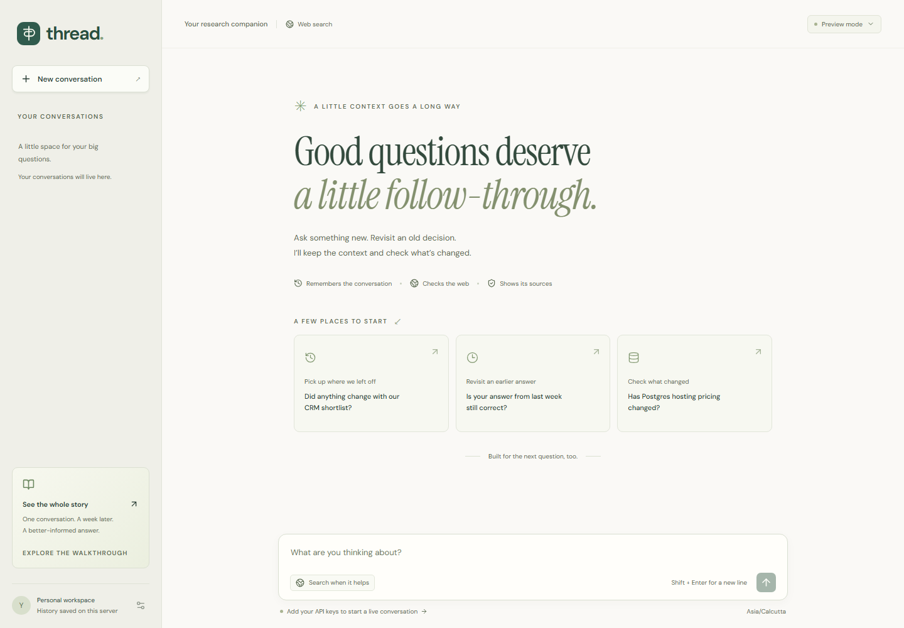
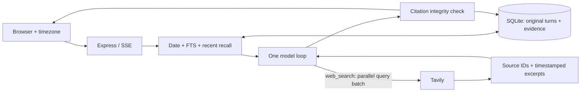

# Thread

**A chat agent that remembers the conversation and checks what changed.**

Built for the minimi hiring challenge. One agent, one model-callable tool (**web search**), durable memory, and evidence you can inspect.

[](https://github.com/Pranay623/minimi-assignment/actions/workflows/ci.yml)



## Run it

Requires **Node.js 24+**. SQLite is built into Node; no database service, Docker, or native database package is needed.

```sh
npm install
npm run dev
```

Open **http://localhost:3000**. Without keys, select **“See the whole story”** for an offline walkthrough. It uses explicitly labeled fictional companies, prices, and excerpts. It never calls a model.

For live chat, copy `.env.example` to `.env` and add a model-provider key plus `TAVILY_API_KEY`. Development mode reloads when `.env` changes. Keys never go to the browser or Git.

| Provider         | Configuration                                                                        |
| ---------------- | ------------------------------------------------------------------------------------ |
| OpenAI (default) | `OPENAI_API_KEY`; `OPENAI_MODEL=gpt-5.4`                                             |
| AgentRouter.org  | `MODEL_PROVIDER=agentrouter`; `AGENTROUTER_API_KEY`; `CHAT_MODEL=<an enabled model>` |
| Google Gemini    | `MODEL_PROVIDER=google`; `GOOGLE_API_KEY`; `CHAT_MODEL=gemini-2.5-flash`             |

AgentRouter uses its documented Chat Completions endpoint at `https://agentrouter.org/v1`. Set `MODEL_API=responses` only for a route supporting that protocol. An existing gateway key in `OPENAI_API_KEY` is also accepted. See [provider setup and troubleshooting](docs/OPERATIONS.md).

## What to try

1. Ask for a shortlist with constraints, then continue in a **new conversation**. History is shared within your browser's workspace.
2. Ask what you discussed on a date. Relative dates use your browser's timezone; the selected date and original exchange are inspectable.
3. Ask whether an earlier answer is still correct. The agent searches again and separates saved observations from new evidence.
4. Open a numbered citation to inspect its excerpt, URL, observation time, and publication date when available.
5. Stop a response and revisit it. Unfinished answers never become completed factual memory; your question survives.

All three challenge prompts are available in the walkthrough, whose clock is fixed at **10 November 2026**. Real conversations use the server clock and never retrieve demo fixtures.

## Architecture



Memory retrieval is application code, **not a second model tool**. Simple conversation takes one model call with zero searches. Research is capped at three search rounds, twelve queries, four model calls, and two minutes. Tool failures become missing evidence and are visible to the user. Search results are not cached across turns.

Read **[DESIGN.md](DESIGN.md)** for the one-page rationale, rejected alternatives, and next steps.

## Verify it

```sh
npm run check                 # TypeScript, unit/integration tests, production build
npm run eval                  # 12 temporal-retrieval scenarios; no keys
npx playwright install chromium
npm run test:e2e               # Browser, mobile layout, accessibility; no API costs
npm run format:check
```

Optional billable checks:

```sh
npm run eval:live              # Real model + real Tavily; one sourced question
npm run eval:model             # Real model + controlled evidence; four behavior scenarios
```

Reports go to ignored `data/`. Deterministic tests do **not** establish model answer quality. See [the evaluation rubric](docs/EVALUATION.md) and [observed validation](docs/VALIDATION.md).

## Code map

| File                                                  | Responsibility                                                   |
| ----------------------------------------------------- | ---------------------------------------------------------------- |
| `server/agent.ts`                                     | Bounded orchestration, cancellation, progress, finalization      |
| `server/memory.ts`                                    | Calendar interpretation and bounded cross-conversation retrieval |
| `server/db.ts`                                        | Owner-scoped SQLite, immutable completed turns, crash recovery   |
| `server/search.ts`                                    | Sole tool schema, argument validation, Tavily adapter            |
| `server/evidence.ts`                                  | Citation registry, URL validation, immutable observations        |
| `server/model.ts`, `chat-model.ts`, `google-model.ts` | Provider transports and opaque within-run continuation           |
| `server/prompt.ts`                                    | Conversation, freshness, comparison, and trust rules             |
| `server/app.ts`                                       | Identity, validation, quotas, SSE                                |
| `src/`                                                | React chat, Markdown, memory and source inspection               |

## Boundaries

This is a local, single-process submission. Anonymous browser identities isolate history; they are **not production authentication**. Lexical retrieval can miss distant paraphrases. Search excerpts may omit important terms. Valid citation IDs do not prove that a claim is supported, and prompts cannot guarantee resistance to every injection.

Production startup: `npm run build`, then `npm start`. Read [operations and privacy](docs/OPERATIONS.md) before exposing the server publicly. AI coding tools were used; the [code walkthrough](docs/CODE_WALKTHROUGH.md) explains the decisions for review and discussion.
